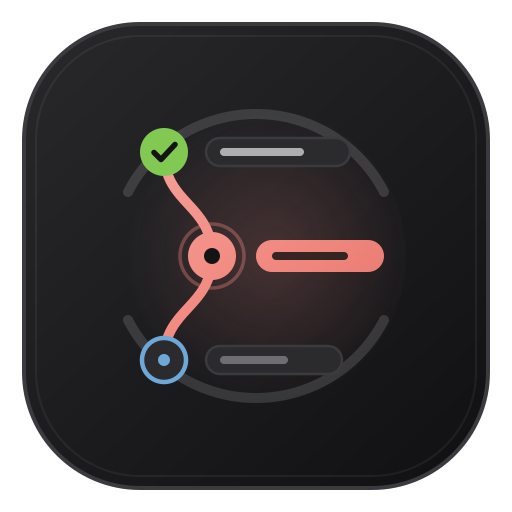

<p align="left">
  
</p>

# Structured • Visual Day Timeline

A sleek, dark-themed visual day planner, project timeframe calendar, and personal progression timeline with procedural Web Audio SFX, 3D memo spike physics, hierarchical Skills tracking, spatial mascot interactions, and Capacitor Android local notifications.


[](https://github.com/HollowEmperor/structured-timeline/releases/latest)

## Features
- **Visual Day Timeline**: Color-coded time blocks with category glyphs, overlap/conflict detection, priority indicators, and Energy 1–5 tagging.
- **Saturday-First Dynamic Calendar & Timeframes**: Adaptive 4-, 5-, and 6-row month grid with multi-project span lanes, tear-off animations, due checkpoints, and Physical/Mental/Gained progress rings ([`calendar-projects-logic.js`](calendar-projects-logic.js)).
- **Day Compartments**: Configurable day windows (Dawn, Morning, Afternoon, Evening) with automated boundary notifications and timeline filtering.
- **Skills, Mastery & Areas of Life**: Recursive multi-depth skill trees, slow-start accelerating Level 1–10 progression, and 7-axis Areas of Life radar tracking ([`progress-system-logic.js`](progress-system-logic.js)).
- **Tactile Spatial Panel, Hole-Punch & Memo Spike**: Slide-out edge drawer, teardrop capture, radial mascot cluster, visual hole-punch effects, and 3D perspective stacked memo spike physics ([`memo-spike-physics.js`](memo-spike-physics.js)).
- **Procedural Web Audio SFX Engine**: 22 synthesized pentatonic and felt-hammer acoustic feedback cues (`paperTear`, `holePunch`, `paperStab`, `levelUp`, etc.) with mute toggle and cooldown control ([`sound-fx-engine.js`](sound-fx-engine.js)).
- **Habit Targets & Horizon Goals**: Cumulative completion tracking (`completedDays / masteryDays`) and multi-horizon goals (Daily, Weekly, Quarterly, Monthly, Vision).
- **Contextual Notification Engine**: Android local notifications powered by `@capacitor/local-notifications` across 4 adaptive tones (Begging, Passive-Aggressive, Sweet, Comforting).
- **Custom Themes**: Multi-theme palette system with on-accent typography contrast and dark-first styling.

## Android Release
Download the latest Android APK from [GitHub Releases](https://github.com/HollowEmperor/structured-timeline/releases/latest).

## Local Development & Verification
This repository runs directly in any modern browser, Google AI Studio, or Express server without a complex bundler step:

```bash
npm install
npm start                # Serves index.html and static assets on port 3000
node --test *.test.mjs   # Runs unit tests for calendar, memo physics, progression, and SFX
npm run build            # Syntax verification for server and modules
```
