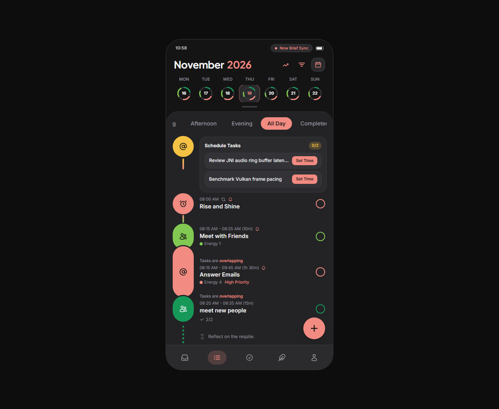

# Structured • Visual Day Timeline

A sleek, dark-themed visual day planner and timeline application.

## Features
- **Visual Day Timeline**: Interactive color-coded timeline nodes with category glyphs.
- **Conflict & Overlap Detection**: Instant visual indicators when scheduled tasks overlap.
- **Priority & Energy Tagging**: Plan around your daily rhythm and task intensity.
- **Calendar & Daily Progress Rings**: Quick day-to-day switching with completion indicators.
- **Backlog & Task Scheduling**: Stash unscheduled tasks and assign them to time slots on the fly.
- **Responsive Mobile Layout**: Optimized for mobile and tablet touch interactions.

## Live Demo
When deployed via GitHub Pages, this repository can be viewed live directly in your browser without any build step required.
